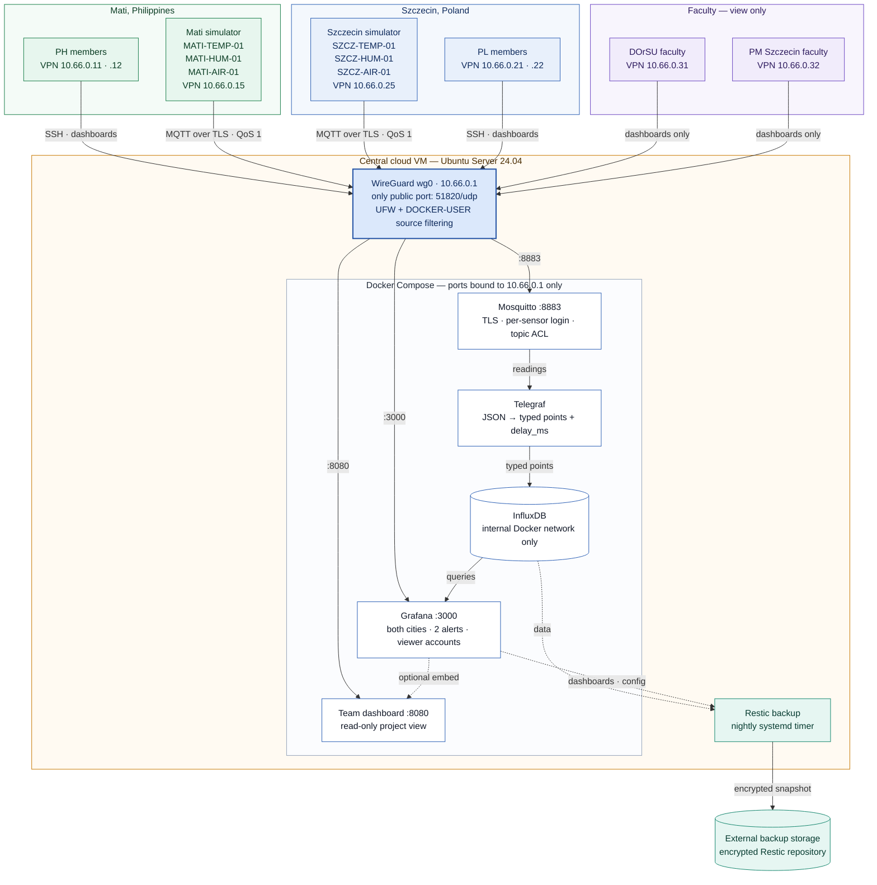

# System Architecture — Project D: Two-City IoT Sensor Dashboard

**Version:** 0.2 · **Status:** Proposal — awaiting review by both pairs · **Updated:** 2026-11-04  
**Related documents:** [data-design.md](data-design.md), [vpn-plan.md](vpn-plan.md)

---

## 1. Purpose and scope

Two simulated sensor sites — Mati, Philippines, and Szczecin, Poland — publish environmental readings over MQTT through a WireGuard VPN to one central cloud VM. The VM authenticates and authorises every publisher, ingests the readings into InfluxDB and presents them through Grafana and a team dashboard. Faculty members use individual VPN profiles and viewer accounts.

Project D intentionally exposes only WireGuard on `51820/udp` to the internet. MQTT, Grafana, the team dashboard and administration interfaces are reachable only through the VPN; InfluxDB remains on the internal Docker network. This statement applies to the Project D deployment and must be confirmed by an external scan of the actual VM.

### Mandatory baseline

- Six simulated sensors and a shared, versioned JSON contract.
- WireGuard, per-sensor MQTT credentials and explicit ACLs.
- MQTT over TLS, QoS 1, retained connection status and missing-reading alerts.
- Persistent storage, two required alerts, delay/interruption/security tests and supporting evidence.
- Nightly external backup and a demonstrated fresh-VM restore.

### Optional extension

Wake-on-LAN and remote computer monitoring are Phase 7 work. They MUST NOT delay or weaken the mandatory baseline.

## 2. Architecture diagram

The arrows show logical data or administration flows, not additional public interfaces. Solid arrows are the mandatory path; dotted arrows are backup or optional flows.

The Mermaid code above is the **only** source of the diagrams. `architecture.png` and `architecture-wol.png` are generated from it with `documents/render-diagrams.sh`; never edit the PNG files by hand. After changing a diagram, run the script and commit the Markdown and PNG files together.

## 3. Component responsibilities

| Component | Responsibility | Network exposure | Persistent state |
| --- | --- | --- | --- |
| Simulators | Generate and validate readings; maintain per-sensor sequence numbers and status; reconnect and drain a bounded offline queue | VPN clients only | Optional local queue and sequence state, as required by the test procedure |
| WireGuard | Authenticate peers and provide the encrypted network path | `51820/udp` on the public interface | Server and peer keys outside Git |
| Mosquitto | Verify credentials and TLS, enforce per-sensor ACLs, retain online/offline status and provide MQTT QoS 1 sessions | `10.66.0.1:8883`, approved VPN sources only | MQTT session state if configured; password file outside Git |
| Telegraf | Subscribe to reading topics, parse and type fields, add `delay_ms`, write to InfluxDB | Docker network plus MQTT connection to Mosquitto | No primary sensor dataset |
| InfluxDB | Store timestamped readings and support dashboard/test queries | Docker network only; no host `ports:` entry | Dedicated Docker volume |
| Grafana | Visualise both cities, evaluate both alert types and provide authenticated viewer access | `10.66.0.1:3000`, approved VPN sources only | Dedicated volume plus versioned provisioning |
| Team dashboard | Provide a simple read-only project view | `10.66.0.1:8080`, approved VPN sources only | No independent source of truth |
| Restic job | Back up database data and required configuration to encrypted external storage | Outbound only | External repository; credentials outside Git |
| UFW / `DOCKER-USER` | Restrict host and container access by interface, source and destination port | Host firewall | Versioned rule scripts plus persisted runtime rules |

Grafana is the mandatory analytics and alerting path. If the team dashboard consumes Grafana output or another read-only API, that integration must be documented before implementation and MUST NOT make InfluxDB public or bypass authentication.

## 4. End-to-end data flow

| Step | Component | Required behaviour |
| --- | --- | --- |
| 1 | Simulator | Every 30 s, each sensor generates a reading with a UTC timestamp at millisecond precision and a per-run sequence number |
| 2 | WireGuard | The reading travels inside the encrypted tunnel towards `10.66.0.1`; only approved source peers can reach MQTT |
| 3 | Mosquitto | TLS, username/password and the explicit per-sensor ACL must all succeed before the reading is accepted |
| 4 | Telegraf | The consumer parses the versioned JSON contract, assigns explicit field types and calculates processing-time delay |
| 5 | InfluxDB | The point is stored in measurement `environment` using the payload timestamp and the tags defined in `data-design.md` |
| 6 | Grafana | Queries return both cities independently; alert evaluation is per sensor, not one global latest-value query |
| 7 | Dashboards | Authenticated users view current readings, connection/silence state, alert history and delay results through the VPN |
| 8 | Evidence | Test scripts retain sequence, restart and clock-offset records before producing summary tables; raw subscriber/broker logs are recommended for optional duplicate analysis |
| 9 | Backup | A nightly Restic job copies the required data and configuration to encrypted external storage; restore is tested separately |

`delay_ms` is calculated at Telegraf processing time. It therefore includes network travel, broker/client queueing and ingestion processing; it is not a pure WireGuard latency metric. Offline messages must be analysed separately from normal traffic. See `data-design.md`, section 7.

## 5. Trust boundaries and security controls

Role allocation is still pending. The table defines required controls and verification, not assignments to either pair.

| Layer | Control | Verification |
| --- | --- | --- |
| Internet perimeter | Project D exposes only `51820/udp`; no published InfluxDB port; services bind to `10.66.0.1` | External port scan plus `ss`/Docker inspection on the VM |
| VPN membership | Individual profiles, unique `/32` assignments and server-side peer public keys | `wg show`, peer registry and denied-peer test |
| Peer-to-peer isolation | Drop forwarding from `wg0` back to `wg0` | A peer cannot reach another peer's VPN address |
| Per-service network access | UFW for host services and `DOCKER-USER` for published container ports | Positive and negative tests for every row of the access matrix |
| MQTT transport | TLS with CA validation and a certificate valid for `10.66.0.1`; no plaintext listener | Plaintext and invalid-certificate connections fail |
| MQTT identity | One username and client ID per sensor; separate Telegraf and dashboard identities | Credential and client-ID tests |
| MQTT authorisation | Explicit topic ACLs; no cross-city wildcard write rule | Own-topic write succeeds; other-topic write fails |
| User access | Named Grafana accounts; faculty are viewers | Viewer cannot administer Grafana, SSH or publish MQTT |
| Host administration | SSH keys only, SSH through VPN only, fail2ban where applicable | Public SSH test fails; VPN admin test succeeds |
| Secrets | `.env` and key material excluded from Git; encrypted backup repository | Secret scan and repository inspection |
| Recovery | External nightly backup and fresh-VM restore | Dated restore log with duration and validation results |

## 6. Startup, persistence and health

1. `wg0` must be active before Docker tries to bind services to `10.66.0.1`. Use the systemd dependency described in `vpn-plan.md`.
2. Docker Compose must define an internal network, named volumes for InfluxDB and Grafana, restart policies and meaningful health checks.
3. Mosquitto must have its TLS certificate, password file and ACL before Telegraf or simulators connect.
4. Telegraf depends on Mosquitto and InfluxDB; Grafana depends on InfluxDB. Dependencies order startup but do not replace retries and health checks.
5. After every reboot, verify VPN, container health, a new reading from each city, dashboard access and the backup timer. A running container alone is not proof of end-to-end health.

## 7. Failure behaviour and recovery

| Failure | Expected behaviour | Evidence / limitation |
| --- | --- | --- |
| VPN interruption at a simulator | Client reconnects; bounded offline queue drains in order; retained status eventually reflects connection state | Record interruption window, sequence gaps, restarts and queue overflow. Duplicate analysis is recommended when pre-ingestion logs are available. QoS 1 does not guarantee zero loss |
| Sensor process stays connected but stops publishing | Connection status may remain `online`; missing-reading alert still fires after the defined threshold | This is why retained status cannot replace the silence alert |
| Mosquitto unavailable | Simulator reports offline and queues within its configured bound; Telegraf reconnects | Recovery test must show restored ingestion without manual container recreation |
| Telegraf or InfluxDB unavailable | MQTT may still accept messages, but dashboard freshness degrades until ingestion recovers | Persistent Telegraf session and QoS 1 help only within their configured limits |
| One stale or malformed payload | Schema validation and a rejection/error log are recommended; no mandatory malformed-payload component is assigned | If implemented, keep the validation result with test evidence and prevent silent field-type changes |
| Cloud VM loss | Rebuild from versioned configuration and restore the latest usable external backup | Record actual recovery time and data-loss window; do not claim an unmeasured RTO |

## 8. Backup and restore policy

- **Included:** InfluxDB data, Grafana database/provisioning needed for recovery, Mosquitto/Telegraf/Compose configuration, dashboard configuration and the restore procedure.
- **Secrets:** never stored in Git. If they are required for restore, store them only in the encrypted backup or a separately approved secret store and document how access is recovered.
- **Excluded:** disposable build output, simulator caches and files that can be regenerated without affecting recovery.
- **Schedule:** nightly. A nightly schedule implies a potential data-loss window of up to roughly 24 hours plus the time since the last successful backup; report the actual last successful backup time.
- **Monitoring:** a completed timer invocation is insufficient. Check Restic's exit status, repository snapshot and available capacity; retain logs.
- **Restore acceptance:** on a fresh VM, restore configuration and data, start the stack, verify historical points and Grafana access, then ingest a new test reading. Record start/end time, snapshot ID, errors and validation results in `tests/restore/restore-log.md`.

## 9. Optional Wake-on-LAN extension (Phase 7 only)

The extension is motivated by power interruptions in Mati. The demonstration takes place in Szczecin; a future Mati deployment would require a separate relay inside the Mati LAN and its own approved addressing, credentials and ACLs.

```mermaid
flowchart LR
    MOB["Mobile app<br/>phone with its own VPN profile"]
    UI["Authorised dashboard user"]
    BE["FastAPI backend :8000<br/>JWT login · audit log"]
    MQ2["Mosquitto :8883<br/>dedicated identity + ACL"]
    subgraph LAN["Szczecin LAN — WoL works only inside one LAN"]
        RL["WoL relay<br/>Raspberry Pi · VPN 10.66.0.41"]
        PC["Approved target computer<br/>MAC allowlist · owner permission"]
    end

    MOB -->|"HTTPS via VPN"| BE
    UI -->|"WoL request via VPN"| BE
    BE -->|"MQTT/TLS · topic …/cmd"| MQ2
    MQ2 -->|"command"| RL
    RL -->|"magic packet<br/>Layer 2 broadcast"| PC
    RL -.->|"ping until it responds"| PC
    RL -->|"topic …/result<br/>sent · reachable · seconds"| MQ2
    MQ2 -->|"result + audit status"| BE

    classDef user fill:#f1ecfb,stroke:#6b46c1,color:#2d1a5e
    classDef svc fill:#ffffff,stroke:#2b5fb4,color:#111827
    classDef lan fill:#e8f0fb,stroke:#2b5fb4,color:#0e2a5c
    class MOB,UI user
    class BE,MQ2 svc
    class RL,PC lan
    style LAN fill:#f4f8fd,stroke:#2b5fb4,color:#0e2a5c
```

The mobile path is explicitly **mobile application → backend → MQTT → local WoL relay**. Phones use individual WireGuard profiles and can reach only the backend extension on `10.66.0.1:8000`; they do not publish directly to MQTT. The backend authenticates the user, authorises the requested target, writes an audit entry and publishes only a validated command.

A Wake-on-LAN magic packet is normally a Layer 2 broadcast and does not cross routers or the WireGuard tunnel. A relay inside the target LAN is therefore required. The relay must accept commands only from its authorised identity, restrict targets to an explicit MAC allowlist and audit every request.

A result of **packet sent** is not proof that the computer woke. Report packet transmission and subsequent target reachability separately, including timeout and failure. Owner permission, BIOS/NIC configuration and behaviour after power loss must be recorded in `wol/wol-feasibility.md`. Computer monitoring in Mati and Szczecin is also optional and uses the reserved Phase 7 topics and peer addresses, not the mandatory sensor path.

## 10. Architecture acceptance checklist

- [ ] External scan and host inspection agree with the VPN access matrix.
- [ ] Every allowed access path succeeds and representative denied paths fail.
- [ ] Six sensors publish valid data; cross-topic publishing and plaintext MQTT fail.
- [ ] Both alerts are tested independently for every applicable sensor query.
- [ ] Delay results include clock offsets and separate normal traffic from queued traffic.
- [ ] VPN interruption evidence distinguishes sequence gaps, restarts and queue overflow; optional duplicate analysis uses suitable pre-ingestion logs when available.
- [ ] Reboot restores the complete service chain without manual fixes.
- [ ] A fresh-VM restore passes its data, access and new-ingestion checks.
- [ ] No secret or real client profile is present in Git.
